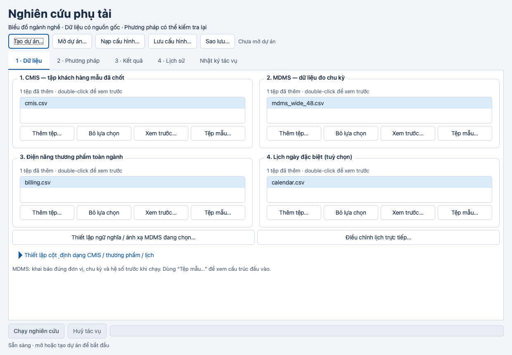
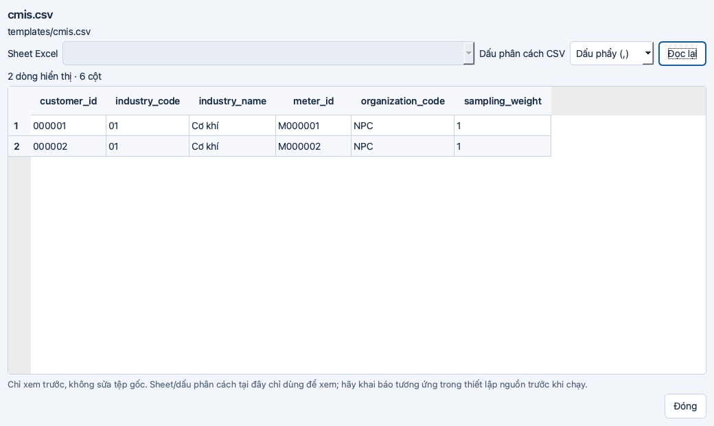

# Kiểm chứng giao diện, template và xem trước tệp

Ngày: 24/10/2026. Nhánh: `feature/desktop-input-ux`. Phạm vi: T29–T33 trong [tasks.md](../../tasks.md).

## Kết quả

| Kiểm tra | Kết quả |
|---|---|
| Toàn bộ pytest | **188/188 pass**, 0 fail/error/skip, lượt cuối 19,63 giây |
| Ruff lint / format | Pass; 80 tệp đã định dạng |
| mypy | Pass; 40 module nguồn |
| Audit requirements.lock | 72 dependency, 0 lỗ hổng đã biết tại thời điểm kiểm tra |
| Build wheel | Thành công, có module theme/preview/template mới |
| Wheel cài ngoài checkout | Import đúng từ wheel, tạo/đọc đủ 7 mẫu CSV và CMIS XLSX, giữ `000001`, mở được các widget mới |
| Qt runtime | Cocoa thực trên macOS và offscreen; nguồn 1240×860, 1024×768, Tab focus, hộp xem trước/mẫu và kết quả demo đạt |

## Lỗi xem trước và regression

- Tái hiện: sau `QListWidget.addItems`, không có current item; nút xem trước vẫn có thể bấm nhưng không phát signal. Thêm/nạp nguồn giờ tự chọn tệp; trạng thái nút theo danh sách, huỷ chọn tệp không mất lựa chọn, thêm trùng được khử và double-click mở đúng nguồn.
- Tên hiển thị ngắn gọn; đường dẫn thật giữ trong `UserRole` và tooltip. Test riêng xác nhận preview và trình sửa ngữ nghĩa MDMS vẫn nhận đường dẫn đầy đủ.
- Preview dùng chung quy tắc header/giá trị với importer; model giữ tối đa 50 dòng, bộ đọc lấy thêm một dòng lookahead để báo còn dữ liệu. Hỗ trợ CSV, XLSX, Parquet và bảng chỉ có tiêu đề; có sheet, dấu phân cách, đọc lại và thông báo giới hạn/lỗi.
- Khi đọc lỗi, bảng cũ được xoá. Mutation bỏ thao tác xoá bảng đã làm regression thất bại đúng tại kiểm tra `rowCount()==0`; source được khôi phục nguyên vẹn trước full suite cuối.
- Red→Green: 4 regression chọn nguồn; 10 trường hợp reader/UI preview; 20 trường hợp template; thêm 2 regression hiển thị tên/giữ đường dẫn. Test dùng tệp CSV/XLSX/Parquet thật và importer thật.

## Template và an toàn dữ liệu

Có 7 loại: CMIS, MDMS dài 30 phút, MDMS rộng 24/48/96 chu kỳ, thương phẩm và lịch. Mỗi mẫu lưu được CSV UTF-8/BOM hoặc XLSX; XLSX có `Dữ liệu` ở đầu và `Hướng dẫn` phía sau, không có công thức. ID và mã ngành là chuỗi. Ba mẫu wide được canonicalize bằng importer thật và đối chiếu số chu kỳ/tổng điện năng ngày độc lập.

Writer chỉ tạo tệp mới từ staging cùng thư mục, publish bằng hard link và từ chối tệp đã tồn tại; dữ liệu nguồn được giữ nguyên. Preview là read-only, không thực thi công thức hoặc mã trong tệp; kiểm tra an toàn archive Excel vẫn áp dụng khi liệt kê sheet. Không thêm dependency, dịch vụ mạng hoặc dữ liệu khách hàng thật; dữ liệu minh hoạ phải được thay trước nghiên cứu.

## Giao diện và ảnh runtime

Theme dùng font hệ thống, thân chữ 14 px, tiêu đề 28/17 px, trạng thái focus/disabled/selection riêng. Các cặp màu chữ được đo có tỷ lệ tương phản: thân chữ 13,79:1; chú thích 6,23:1; nút chính 6,81:1; disabled 5,34:1; selection 11,36:1; lỗi 6,02:1. Bảng nguồn vẫn đọc được khi palette ứng dụng ban đầu là dark.

Kiểm tra 11 ảnh trạng thái: trống; nguồn ở hai kích thước; thiết lập mở rộng; preview hợp lệ/lỗi; mẫu CMIS/MDMS và hướng dẫn cột; kết quả demo có biểu đồ, thành phần và bảng chu kỳ. Bốn nút preview được kiểm tra nằm trong viewport laptop; nhãn trục vật lý chia hai dòng để không bị cắt. Các bảng dài/rộng dùng thanh cuộn và vùng biểu đồ/bảng có thể kéo chia lại.





Lệnh tái lập từ thư mục repository:

```bash
PYTHONPATH=src QT_QPA_PLATFORM=cocoa .venv/bin/python packaging/smoke_inputs.py --output ci-results/ui-refresh-cocoa
PYTHONPATH=src QT_QPA_PLATFORM=offscreen .venv/bin/python packaging/smoke_inputs.py --output ci-results/ui-refresh
```

Thêm `--result <result.json của run demo>` để kiểm tra cả tab kết quả. Script dùng mẫu đã kiểm soát, không tự chạy nghiên cứu với dữ liệu khách hàng.

Lượt Cocoa kết thúc exit 0, nhưng stderr có thông báo `getApplicationProperty: called with invalid property`; chưa xác định nguồn thông báo, không có exception Python hay bước smoke thất bại. Đợt này xác minh GUI trên macOS; GUI Windows, bản native mới và nghiệm thu máy sạch vẫn cần kiểm chứng theo E02. Preview đầu tệp không thay thế kiểm tra toàn bộ nguồn; E01/E03 giữ phạm vi riêng.

## Rà soát

Diff được kiểm tra theo đúng/sai, kiến trúc, khả năng đọc, dữ liệu đầu vào, hiệu năng và bảo mật; không còn finding Required/Critical. Theme được gom về một module, preview/template có widget riêng, phần ngữ nghĩa nghiên cứu và snapshot không thay đổi. Raw JUnit, audit, mutation và ảnh đầy đủ nằm trong `ci-results/` cục bộ; repository giữ báo cáo và hai ảnh đã kiểm tra, không chứa dữ liệu khách hàng thật.
